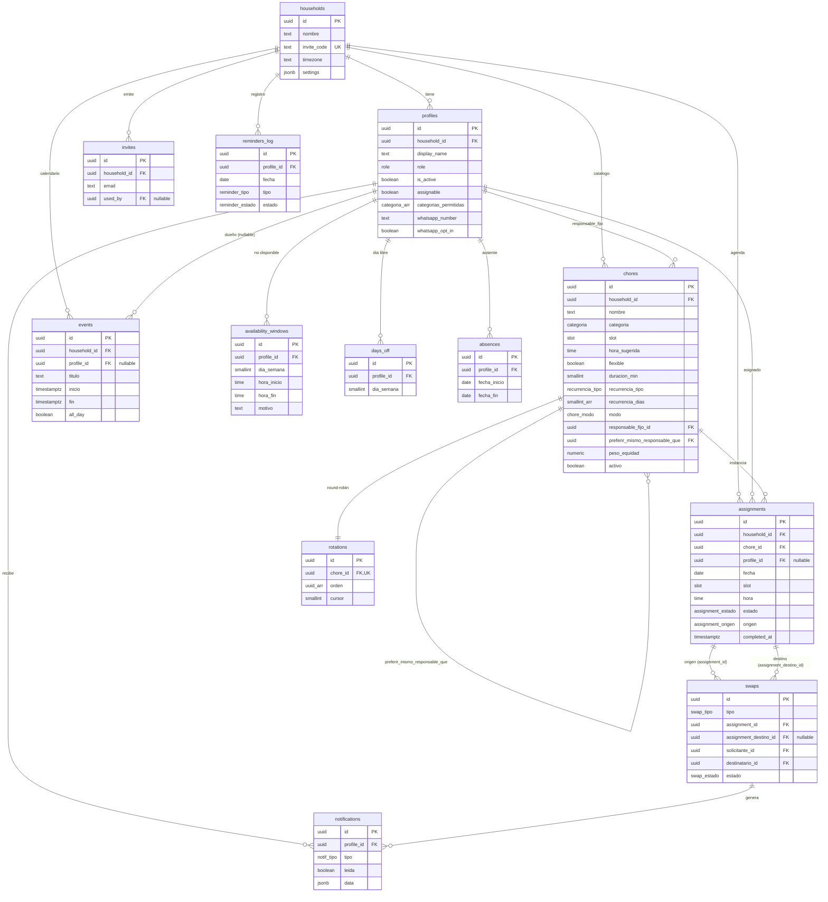

# Mi Turno — Plan de Arquitectura e Implementación

> Documento de planificación. **No** contiene código de la app; guía la construcción.
> Proyecto doble: (1) Proyecto Integrador 1 CENFOTEC — 15 semanas, 4 entregas; (2) producción real para una familia de 5.
> La app se construye **entera de una vez**; las "fases" son solo el envoltorio de entregas académicas.

- **Repo app**: `/Users/macm/mi-turno` (`create-next-app`: App Router, TS, Tailwind v4, `src/`, Turbopack, Next `16.3.4`, React `19.2`).
- **Repo académico**: `/Users/macm/mi-turno-integrador` (`entrega-1..4`, `docs/`).
- **Cierre de fase**: tag `entrega-N` en `mi-turno` + actualización de `entrega-N-*/` en este repo.

---

## 0. Decisiones transversales

| Tema | Decisión |
|---|---|
| Runtime | Next.js 16 App Router, RSC por defecto. Antes de codear, la sesión de build **debe** leer `node_modules/next/dist/docs/` (lo exige `AGENTS.md`): `cookies()` es async, `params`/`searchParams` son `Promise`, middleware puede llamarse `proxy`. |
| Idioma | Español único. Diccionario centralizado `src/lib/i18n/es.ts` + helper `t()`. `<html lang="es">`. Sin `next-intl`. Estructura lista para EN futuro. |
| Zona horaria | `America/Costa_Rica` (UTC−6, **sin DST**). Todo cálculo de "hoy" / día-de-semana ocurre en el servidor con esa TZ (`src/lib/dates.ts`). Nunca `new Date()` local del cliente para lógica. |
| Estilado | Tailwind v4 CSS-first (`@theme`), tokens shadcn. |
| Componentes | shadcn/ui (CLI canary por React 19 / TW v4). Commodity primero (21st.dev) para tablas, formularios, navbar, modales; secciones firma (dashboard "Hoy", timeline del calendario) custom. |
| Motion | Framer Motion. `useReducedMotion()` siempre; animar solo `transform`/`opacity`; import lazy; variantes en `src/lib/animations.ts`; `CLS = 0`. Scope: entrada de sección, stagger de listas de tareas, `whileTap`/`whileHover` en botones y cards, `AnimatePresence` día↔mes y lista de notificaciones, skeletons. Sin parallax. |
| Tema | `next-themes` (`attribute="class"`, `defaultTheme="system"`), toggle en nav y en `/ajustes`. Tokens en `:root` / `.dark`. |
| Datos | Supabase hosted **us-east-1** (VPS/consumo del lado este; RTT app↔DB). Auth email+password, Postgres, RLS en todas las tablas. |
| Seguridad clave | El navegador **jamás** usa `service_role`. `service_role` solo en `src/server/supabase/admin.ts`, importable únicamente desde `src/server/**` (regla ESLint `no-restricted-imports`). |
| Deploy | Vercel + GitHub. Commits sin rastro de asistente (preferencia del usuario). Confirmar remoto de `mi-turno`. |
| Realtime | Fase 1: `revalidate` + refetch on focus. Supabase Realtime opcional en Fase 2 para notificaciones/dashboard en vivo. |
| Auth email | Confirmación por email **desactivada** en Supabase (5 usuarios conocidos, sin SMTP). Confirmar. |

---

## 1. Arquitectura Next.js

### 1.1 Estructura de `src/`

```
src/
  middleware.ts                      # refresco de sesión + protección de rutas (app)
  app/
    layout.tsx                       # root: <html lang="es">, fuentes, ThemeProvider, Toaster
    globals.css                      # tokens TW v4 + shadcn (:root / .dark)
    manifest.ts                      # PWA manifest (metadata route)
    icon.tsx / apple-icon.png        # iconos PWA
    global-error.tsx                 # boundary raíz
    offline/page.tsx                 # fallback offline del SW
    (auth)/
      layout.tsx                     # layout desnudo, redirige a / si ya hay sesión
      login/page.tsx
      registro/page.tsx
    (app)/
      layout.tsx                     # shell: nav lateral/inferior, guard de sesión, providers de datos
      error.tsx                      # boundary de la zona autenticada (client)
      loading.tsx
      not-found.tsx
      page.tsx                       # Dashboard "Hoy"
      calendario/page.tsx            # vista día
      calendario/mes/page.tsx        # vista mes
      catalogo/page.tsx              # lista + filtros (categoría, modo, texto)
      catalogo/nueva/page.tsx        # form crear
      catalogo/[choreId]/page.tsx    # form editar + config de rotación
      asignaciones/page.tsx          # historial + búsqueda/filtrado
      intercambios/page.tsx          # swaps recibidos / enviados / crear
      disponibilidad/page.tsx        # ventanas no-disp, día libre, ausencias (de las 5 personas)
      eventos/page.tsx               # eventos familiares CRUD
      notificaciones/page.tsx        # bandeja in-app
      ajustes/page.tsx               # hogar (nombre, horas de recordatorio, código) + mi perfil (WhatsApp, opt-out, tema)
      usuarios/page.tsx              # SOLO admin — invitar, desactivar, rol, categorías, assignable, acciones destructivas
    api/
      registro/route.ts             # POST — valida código, crea auth user + profile (service_role)
      dashboard/route.ts            # GET  — datos del dashboard (scope=yo|hogar)
      assignments/route.ts          # GET  — historial filtrable / calendario
      assignments/[id]/route.ts     # PATCH — cambiar estado (hecha|saltada)
      chores/route.ts              # GET  — catálogo filtrable
      swaps/route.ts               # POST — proponer intercambio/cobertura
      swaps/[id]/route.ts          # PATCH — aceptar|rechazar|cancelar (transacción)
      notifications/route.ts       # GET
      notifications/[id]/route.ts  # PATCH — marcar leída
      cron/materialize/route.ts    # GET/POST protegido — materializa día(s)
      cron/reminders/route.ts      # GET protegido — ?tipo=matutino|nocturno
  components/
    ui/                              # shadcn
    layout/  (Nav, ThemeToggle, InstallPrompt, RoleGate)
    dashboard/  calendar/  chores/  assignments/  swaps/  availability/  events/  notifications/
  server/
    supabase/server.ts               # createServerClient (anon + sesión, cookies async)
    supabase/admin.ts                # createClient (service_role) — solo server/**
    supabase/middleware.ts           # updateSession()
    auth/guards.ts                   # requireUser(), requireProfile(), requireAdmin(), requireActiveMember()
    services/                        # lógica pura, reutilizada por actions y route handlers
      households.ts profiles.ts invites.ts chores.ts rotations.ts
      assignments.ts materialize.ts equity.ts availability.ts absences.ts
      events.ts swaps.ts notifications.ts reminders.ts bridge.ts
    actions/                         # 'use server' — acciones de formulario
      auth.ts chores.ts assignments.ts availability.ts events.ts
      swaps.ts users.ts household.ts profile.ts
  lib/
    supabase/client.ts               # createBrowserClient (anon) — Client Components
    api/envelope.ts                  # apiOk / apiError / AppError / códigos
    api/fetcher.ts                   # wrapper fetch tipado para Client Components
    validation/                      # esquemas zod compartidos client+server
    dates.ts  animations.ts  constants.ts
    i18n/es.ts  i18n/index.ts
  types/
    db.ts                            # generado por Supabase CLI
    domain.ts                        # tipos de dominio derivados
  hooks/
```

### 1.2 Server vs Client Components

| Usar **Server Component** | Usar **Client Component** |
|---|---|
| Todas las `page.tsx` como shell: cargan datos con el cliente server de Supabase, resuelven `requireProfile()`, pasan props | Formularios (`react-hook-form` + `zodResolver`), toggles de estado, filtros interactivos, timeline del calendario, toasts |
| Listas de solo lectura renderizadas en el primer paint (SEO no importa, pero sí TTFB y menos JS) | Botón "marcar hecha/saltada" (hace `fetch` PATCH y actualiza optimista) |
| `/usuarios` — hace `requireAdmin()` y renderiza `<Forbidden/>` si no | Barra de filtros de `/asignaciones` (empuja `searchParams` y refetch a `/api/assignments`) |
| Dashboard: primer render con datos del server; el toggle "solo yo / hogar" y el refetch son client | `InstallPrompt`, `ThemeToggle`, `AnimatePresence` |

Regla: **datos entran por Server Component**; interacción y `fetch` incremental por Client Component contra los Route Handlers.

### 1.3 Server Actions vs Route Handlers

**Server Actions** (`src/server/actions/*`, `'use server'`) — mutaciones disparadas por formularios, con `useActionState`:
- registro / login / logout
- crear/editar/borrar chore, configurar rotación
- crear/editar/borrar ventana de disponibilidad, día libre, ausencia, evento
- crear asignación manual, reasignar
- admin: invitar, desactivar, cambiar rol, editar `categorias_permitidas` / `assignable`, **vaciar historial**, **borrar hogar**
- ajustes del hogar y de perfil

**Route Handlers** (`src/app/api/*`) — superficie REST/JSON consumida por Client Components vía `fetch` (cubre explícitamente *"consumo de API"* y *"AJAX/fetch"* de la rúbrica) + endpoints de cron:

| Método + ruta | Rol | Descripción | Consumidor |
|---|---|---|---|
| `POST /api/registro` | público | Valida `households.invite_code`, crea usuario + `profile` | Form de registro (alternativa a la action) |
| `GET /api/dashboard?scope=yo\|hogar&fecha=` | member+ | Tareas de hoy agrupadas por persona, % cumplimiento, próximos 3 días, notifs pendientes | Dashboard (toggle, refetch on focus) |
| `GET /api/assignments?persona=&estado=&categoria=&desde=&hasta=&q=&page=` | member+ | Historial filtrable + búsqueda por nombre de tarea | Tabla de `/asignaciones`, calendario |
| `PATCH /api/assignments/:id` `{ estado }` | member+ | `pendiente\|hecha\|saltada`; setea `completed_at/by` | Botón del dashboard y del día |
| `GET /api/chores?categoria=&modo=&q=` | member+ | Catálogo filtrable | Lista de `/catalogo` |
| `POST /api/swaps` `{ assignment_id, destinatario_id, tipo, assignment_destino_id?, mensaje? }` | member+ | Crea swap `pendiente` + notificación | Modal de intercambio |
| `PATCH /api/swaps/:id` `{ accion: aceptar\|rechazar\|cancelar }` | member+ | Confirmación bilateral; en `aceptar` ejecuta la reasignación en transacción | Bandeja de intercambios |
| `GET /api/notifications?leida=` | member+ | Notificaciones del usuario | `/notificaciones`, badge del nav |
| `PATCH /api/notifications/:id` `{ leida: true }` | member+ | Marcar leída | idem |
| `GET\|POST /api/cron/materialize` | cron secret | Materializa hoy + 3 días para todos los hogares | Vercel Cron |
| `GET /api/cron/reminders?tipo=` | cron secret | Envía recordatorios vía bridge, idempotente | Vercel Cron |

**Envelope JSON** (`src/lib/api/envelope.ts`):

```ts
// éxito
{ ok: true, data: <T> }
// error
{ ok: false, error: { code: ErrorCode, message: string, details?: unknown } }

type ErrorCode =
  | 'AUTH_REQUIRED'   // 401
  | 'FORBIDDEN'       // 403  (gate de rol)
  | 'NOT_FOUND'       // 404
  | 'VALIDATION'      // 422  (zod)
  | 'CONFLICT'        // 409  (idempotencia, swap ya resuelto)
  | 'RATE_LIMIT'      // 429
  | 'BRIDGE_ERROR'    // 502  (fallo del bridge de Mithra)
  | 'INTERNAL'        // 500
```

Los `services/*` lanzan `AppError(code, message, httpStatus)`. Route handlers hacen `try/catch` → envelope. Server Actions devuelven `{ ok:false, error }` para `useActionState`. `sonner` (shadcn) muestra los errores de `fetch`.

### 1.4 Clientes Supabase

| Archivo | Fábrica | Clave | Uso |
|---|---|---|---|
| `src/lib/supabase/client.ts` | `createBrowserClient` (`@supabase/ssr`) | anon | Client Components |
| `src/server/supabase/server.ts` | `createServerClient` + `await cookies()` | anon + JWT del usuario | Server Components, Server Actions, Route Handlers |
| `src/server/supabase/middleware.ts` | `createServerClient` con `request/response` cookies | anon + JWT | `updateSession()` en `middleware.ts` |
| `src/server/supabase/admin.ts` | `createClient` (`persistSession:false`) | **service_role** | Solo registro, cron, transacción de swap, purga de historial, borrado de hogar |

`no-restricted-imports` en ESLint: prohíbe importar `server/supabase/admin` fuera de `src/server/**`.

### 1.5 Middleware de sesión

`src/middleware.ts`:
```
matcher: todas las rutas salvo assets, /login, /registro, /api/cron/*
1. updateSession(request)  -> refresca cookies de Supabase
2. si no hay user           -> redirect /login?next=<path>
3. si path empieza con /usuarios y profile.role !== 'admin' -> rewrite a /usuarios (la page renderiza 403) 
   (el gate real vive en la page + en las actions; el middleware es solo atajo)
4. next()
```
El middleware **no** consulta la BD para el rol si se puede evitar (coste por request); lee un claim del JWT si se configura un custom access token hook en Supabase que inyecte `role` y `household_id`. Si no, el gate de `/usuarios` queda 100% en la Server Component (`requireAdmin()` → `<Forbidden/>`), que igual es lo demostrable.

### 1.6 Manejo de errores

- `app/(app)/error.tsx` (client) — boundary de la zona autenticada, mensaje amable + botón "Reintentar" (`reset()`).
- `app/global-error.tsx` — fallback raíz.
- `app/(app)/not-found.tsx` y `notFound()` desde las pages cuando el recurso no existe o no pertenece al hogar.
- `<Forbidden/>` — componente 403 reutilizable (no redirect, para que sea **demostrable** en `/usuarios`).
- Validación de formularios: esquemas zod en `src/lib/validation` compartidos; `react-hook-form` + `zodResolver` en cliente, **revalidación** en la action / route (nunca confiar en el cliente).
- Errores de red en Client Components: `fetcher.ts` normaliza el envelope y lanza; `sonner` los muestra.

### 1.7 i18n mínima

- `src/lib/i18n/es.ts`: objeto plano `{ 'dashboard.title': 'Hoy', ... }`.
- `t(key, params?)` en `src/lib/i18n/index.ts` (interpolación simple, sin dependencia).
- Fechas: `Intl.DateTimeFormat('es-CR', { timeZone: 'America/Costa_Rica', ... })` centralizado en `dates.ts`.
- Todos los textos de UI pasan por `t()` — facilita el manual de usuario y una traducción EN futura.

### 1.8 PWA

- `app/manifest.ts` (metadata route): `name:"Mi Turno"`, `short_name:"Mi Turno"`, `start_url:"/"`, `display:"standalone"`, `background_color`, `theme_color`, `icons` 192/512 + `maskable`, `lang:"es"`, `dir:"ltr"`.
- Service Worker: **Serwist** (`@serwist/next`) — mantenido para Next 15/16 App Router. Config en `next.config.ts` + `app/sw.ts`.
  - Precache del app shell.
  - Runtime: `NetworkFirst` para `/api/*` (con timeout y cache de respaldo para `/api/dashboard`), `StaleWhileRevalidate` para estáticos y fuentes.
  - Fallback offline → `/offline`.
- `InstallPrompt` (client): escucha `beforeinstallprompt`, botón "Instalar" en el nav / ajustes.
- `viewport` + `themeColor` en `metadata` de `layout.tsx` (claro/oscuro).
- Verificar en Vercel: `sw.js` servido sin cache larga (Serwist lo maneja).

### 1.9 Tema claro/oscuro

- Reemplazar el bloque `@media (prefers-color-scheme: dark)` del scaffold por tokens **class-based** (`.dark`).
- `globals.css`: definir el set completo de tokens shadcn (`--background --foreground --card --popover --primary --secondary --muted --accent --destructive --border --input --ring --radius`) en `:root` y `.dark`, expuestos a Tailwind v4 vía `@theme inline`.
- `ThemeProvider` (`next-themes`) en `app/layout.tsx`; `next-themes` inyecta el script anti-FOUC.
- Toggle: `system / claro / oscuro`, persistido; también en `/ajustes`.

---

## 2. Modelo de datos

### 2.1 Enums

```sql
create type role              as enum ('admin','member');
create type categoria         as enum ('perros','casa');
create type slot              as enum ('manana','noche','puntual');
create type chore_modo        as enum ('fijo','rotativo');
create type recurrencia_tipo  as enum ('diaria','dias_semana');
create type assignment_estado as enum ('pendiente','hecha','saltada');
create type assignment_origen as enum ('manual','rotacion','motor');
create type swap_tipo         as enum ('intercambio','cobertura');
create type swap_estado       as enum ('pendiente','aceptado','rechazado','cancelado');
create type notif_tipo        as enum ('swap_solicitud','swap_aceptado','swap_rechazado','recordatorio');
create type reminder_tipo     as enum ('matutino','nocturno');
create type reminder_estado   as enum ('enviado','fallido','omitido');
```
Día de semana: `smallint` 0–6, **0 = domingo** (consistente con `EXTRACT(DOW ...)` de Postgres).

### 2.2 Tablas

#### `households`
| col | tipo | notas |
|---|---|---|
| id | uuid pk | `default gen_random_uuid()` |
| nombre | text not null | |
| invite_code | text not null unique | código compartido; rotable por admin |
| timezone | text not null | `default 'America/Costa_Rica'` |
| settings | jsonb not null | `default '{"load_window_days":14,"reminder_matutino":"06:30","reminder_nocturno":"21:00","engine_enabled":false}'` |
| created_at | timestamptz | `default now()` |

Índice: `unique(invite_code)`.

#### `profiles`
| col | tipo | notas |
|---|---|---|
| id | uuid pk | = `auth.users.id` (`references auth.users on delete cascade`) |
| household_id | uuid not null | `references households(id) on delete cascade` |
| display_name | text not null | |
| email | text not null | |
| role | role not null | `default 'member'` |
| is_active | boolean not null | `default true` |
| assignable | boolean not null | `default true` — **Unye = false** |
| categorias_permitidas | categoria[] not null | `default '{perros,casa}'` — Melissa `{perros}`, Unye `{}` |
| whatsapp_number | text | E.164 (`50688887777`); null = sin recordatorio |
| whatsapp_opt_in | boolean not null | `default true` |
| created_at | timestamptz | `default now()` |

Índices: `(household_id)`, `(household_id) where is_active`.
`dia_libre` **no** es columna: vive en `days_off` (permite 0..n y es más uniforme para el motor).

#### `invites`  (capa de "invitar usuario" del admin + auditoría)
| col | tipo | notas |
|---|---|---|
| id | uuid pk | |
| household_id | uuid not null | fk households |
| email | text not null | invitado esperado |
| created_by | uuid not null | fk profiles |
| used_by | uuid | fk profiles, null hasta que se registra |
| used_at | timestamptz | |
| expires_at | timestamptz | |
| created_at | timestamptz | `default now()` |

Índice: `(household_id, email)`. El registro valida contra `households.invite_code`; `invites` solo documenta la intención y marca `used_by/used_at` al completarse.

#### `chores`  (catálogo — **entidad principal / CRUD de rúbrica**)
| col | tipo | notas |
|---|---|---|
| id | uuid pk | |
| household_id | uuid not null | fk households |
| nombre | text not null | |
| categoria | categoria not null | |
| slot | slot not null | |
| hora_sugerida | time | nullable |
| flexible | boolean not null | `default false` — sin hora fija, cualquier momento (salta el chequeo de ventana) |
| duracion_min | smallint | nullable; default por slot si null (ver §4) |
| recurrencia_tipo | recurrencia_tipo not null | `default 'diaria'` |
| recurrencia_dias | smallint[] | requerido si `dias_semana` (ej. `{0}` = domingo) |
| modo | chore_modo not null | `default 'rotativo'` |
| responsable_fijo_id | uuid | fk profiles; requerido si `modo='fijo'` |
| preferir_mismo_responsable_que | uuid | fk `chores(id)`; misma persona que otra tarea |
| peso_equidad | numeric(4,2) not null | `default 1.0` |
| activo | boolean not null | `default true` |
| created_at / updated_at | timestamptz | trigger `updated_at` |

Índices: `(household_id, activo)`, `(household_id, categoria)`, `(household_id, modo)`.
Checks: `modo='fijo' => responsable_fijo_id not null`; `recurrencia_tipo='dias_semana' => array_length(recurrencia_dias,1) >= 1`.

#### `rotations`  (round-robin MVP)
| col | tipo | notas |
|---|---|---|
| id | uuid pk | |
| chore_id | uuid not null unique | fk chores on delete cascade |
| household_id | uuid not null | fk (denormalizado para RLS) |
| orden | uuid[] not null | profile_ids en orden de rotación |
| cursor | smallint not null | `default 0` — índice del próximo |
| updated_at | timestamptz | |

#### `assignments`  (instancia diaria)
| col | tipo | notas |
|---|---|---|
| id | uuid pk | |
| household_id | uuid not null | fk (denormalizado) |
| chore_id | uuid not null | fk chores on delete cascade |
| profile_id | uuid | fk profiles; **null = sin asignar** (motor no encontró candidato) |
| fecha | date not null | |
| slot | slot not null | copiado del chore al materializar |
| hora | time | copiada de `hora_sugerida` |
| estado | assignment_estado not null | `default 'pendiente'` |
| origen | assignment_origen not null | |
| completed_at | timestamptz | |
| completed_by | uuid | fk profiles |
| nota | text | |
| created_by | uuid | fk profiles (null si cron) |
| created_at / updated_at | timestamptz | |

Índices: **`unique(chore_id, fecha)`** (idempotencia de materialización), `(household_id, fecha)`, `(profile_id, fecha)`, `(household_id, estado, fecha)`, `(chore_id, profile_id, estado)` (para "hace cuánto la hizo").

#### `availability_windows`  (NO disponibilidad semanal recurrente)
| col | tipo | notas |
|---|---|---|
| id | uuid pk | |
| household_id | uuid not null | fk |
| profile_id | uuid not null | fk profiles on delete cascade |
| dia_semana | smallint not null | 0–6 |
| hora_inicio | time not null | |
| hora_fin | time not null | `check hora_fin > hora_inicio` |
| motivo | text | trabajo / clase / actividad |
| created_at | timestamptz | |

Índice: `(household_id, profile_id, dia_semana)`.

#### `days_off`  (día libre — 0 tareas ese día)
| col | tipo | notas |
|---|---|---|
| id | uuid pk | |
| household_id | uuid not null | fk |
| profile_id | uuid not null | fk profiles on delete cascade |
| dia_semana | smallint not null | 0–6 |
| — | | `unique(profile_id, dia_semana)` |

#### `absences`  (ausencia con rango)
| col | tipo | notas |
|---|---|---|
| id | uuid pk | |
| household_id | uuid not null | fk |
| profile_id | uuid not null | fk profiles on delete cascade |
| fecha_inicio | date not null | |
| fecha_fin | date not null | `check fecha_fin >= fecha_inicio` |
| motivo | text | |
| created_by | uuid | fk profiles |
| created_at | timestamptz | |

Índice GiST opcional `daterange(fecha_inicio, fecha_fin, '[]')` para solapes; para el volumen familiar basta `(household_id, profile_id, fecha_inicio, fecha_fin)`.

#### `events`  (calendario familiar; incluye a Unye)
| col | tipo | notas |
|---|---|---|
| id | uuid pk | |
| household_id | uuid not null | fk |
| profile_id | uuid | fk profiles; **null = todo el hogar** |
| titulo | text not null | |
| descripcion | text | |
| inicio | timestamptz not null | |
| fin | timestamptz not null | `check fin >= inicio` |
| all_day | boolean not null | `default false` |
| created_by | uuid | fk profiles |
| created_at | timestamptz | |

Índice: `(household_id, inicio)`.

#### `swaps`
| col | tipo | notas |
|---|---|---|
| id | uuid pk | |
| household_id | uuid not null | fk |
| tipo | swap_tipo not null | `cobertura` = la otra persona hace mi tarea; `intercambio` = se cambian dos asignaciones |
| assignment_id | uuid not null | fk assignments — la asignación del **solicitante** |
| assignment_destino_id | uuid | fk assignments — requerido si `tipo='intercambio'` (asignación del destinatario) |
| solicitante_id | uuid not null | fk profiles |
| destinatario_id | uuid not null | fk profiles |
| estado | swap_estado not null | `default 'pendiente'` |
| mensaje | text | |
| resolved_at | timestamptz | |
| created_at | timestamptz | |

Índices: `(household_id, estado)`, `(destinatario_id, estado)`, `(solicitante_id, estado)`.
Check: `tipo='intercambio' => assignment_destino_id not null`.

#### `notifications`  (in-app)
| col | tipo | notas |
|---|---|---|
| id | uuid pk | |
| household_id | uuid not null | fk |
| profile_id | uuid not null | fk profiles — destinatario |
| tipo | notif_tipo not null | |
| titulo | text not null | |
| cuerpo | text | |
| data | jsonb | `{ swap_id, assignment_id, ... }` |
| leida | boolean not null | `default false` |
| created_at | timestamptz | |

Índice: `(profile_id, leida, created_at desc)`.

#### `reminders_log`  (idempotencia de recordatorios — sin acceso desde el navegador)
| col | tipo | notas |
|---|---|---|
| id | uuid pk | |
| household_id | uuid not null | fk |
| profile_id | uuid not null | fk profiles |
| fecha | date not null | |
| tipo | reminder_tipo not null | |
| canal | text not null | `default 'whatsapp'` |
| estado | reminder_estado not null | |
| payload | jsonb | mensaje + destino |
| error | text | |
| enviado_at | timestamptz | `default now()` |
| — | | **`unique(profile_id, fecha, tipo)`** |

### 2.3 Diagrama ER (Mermaid)



### 2.4 Datos semilla (`scripts/seed.ts` + `supabase/seed.sql`)

Usuarios auth creados vía Admin API con UUIDs fijos; luego `profiles` y el resto por SQL.

**Household**: `nombre='Casa Chung'`, `invite_code` aleatorio, `settings.engine_enabled=false`.

**Profiles**

| Persona | role | assignable | categorias_permitidas | día libre | WhatsApp |
|---|---|---|---|---|---|
| Jennifer (mamá) | member | sí | `{perros,casa}` | miércoles (3) | sí |
| Unye (papá) | member | **no** | `{}` | — | no |
| Melissa (hna mayor) | member | sí | `{perros}` | ninguno | confirmar (vive fuera) |
| Mariana "Nana" | member | sí | `{perros,casa}` | sábado (6) | sí |
| Mathias (dev) | **admin** | sí | `{perros,casa}` | viernes (5) | sí |

**availability_windows** (0=Dom … 5=Vie; 6=Sáb)

| Persona | Ventanas de NO disponibilidad |
|---|---|
| Melissa | Lun/Mar/Vie 08:00–17:00 · Jue 08:00–16:00 · Jue 18:00–19:00 (actividad) |
| Mariana | Lun 08:00–17:00 · Mar 08:00–17:00 · Mié 09:00–17:00 · Jue 08:00–17:00 · Vie 09:00–17:00 |
| Mathias | Lun 08:00–12:00 · Mié 08:00–12:00 · Mar 13:00–22:00 · Jue 18:00–22:00 · Vie 13:00–17:00 |
| Jennifer | — (siempre disponible) |

**chores** (todas `modo='rotativo'`, `activo=true`)

| nombre | categoria | slot | hora_sugerida | flexible | recurrencia | preferir_mismo_responsable_que |
|---|---|---|---|---|---|---|
| Comer perros mañana | perros | manana | 07:25 | no | diaria | — |
| Pasear perros mañana | perros | manana | 07:30 | no | diaria | → Comer perros mañana |
| Lavar terraza + cochera (mañana) | casa | manana | — | **sí** | diaria | — |
| Comer perros noche | perros | noche | 19:30 | no | diaria | — |
| Hacer comida de perros (noche) | perros | noche | — | no | diaria | — |
| Lavar terraza + cochera (noche) | casa | noche | — | **sí** | diaria | — |
| Sacar basura | casa | noche | — | no | `dias_semana {0}` (domingo) | — |

`rotations.orden` inicial para cada chore: personas `assignable` con la categoría permitida, en orden `[Jennifer, Mariana, Mathias, Melissa]` (Melissa solo en las de `perros`).

---

## 3. Diseño RLS

### 3.1 Funciones helper (SECURITY DEFINER, bypass RLS, sin recursión)

```sql
create schema if not exists app;

create or replace function app.current_household_id() returns uuid
  language sql stable security definer set search_path = public as $$
  select household_id from profiles where id = auth.uid();
$$;

create or replace function app.is_admin() returns boolean
  language sql stable security definer set search_path = public as $$
  select exists (select 1 from profiles
                 where id = auth.uid() and role = 'admin' and is_active);
$$;

create or replace function app.is_active_member() returns boolean
  language sql stable security definer set search_path = public as $$
  select exists (select 1 from profiles
                 where id = auth.uid() and is_active);
$$;
```
`revoke execute ... from anon; grant execute ... to authenticated;`

### 3.2 Política general

- **Todas** las tablas: `ENABLE ROW LEVEL SECURITY` + `FORCE ROW LEVEL SECURITY`.
- Aislamiento por hogar en cada política: `household_id = app.current_household_id()`.
- **member puede casi todo** dentro de su hogar (SELECT/INSERT/UPDATE/DELETE) en: `chores`, `rotations`, `assignments`, `availability_windows`, `days_off`, `absences`, `events`.
- **admin exclusivo**: gestión de usuarios (`invites`, columnas privilegiadas de `profiles`) y **acciones destructivas** (borrar hogar, vaciar historial, rotar `invite_code`). Lo destructivo masivo va por **Server Action con `admin` client**, no por RLS.
- El navegador nunca ve `service_role`.

### 3.3 Políticas por tabla

| Tabla | SELECT | INSERT | UPDATE | DELETE |
|---|---|---|---|---|
| **households** | `id = current_household_id()` | — (solo en registro, service_role) | `id = current_household_id() AND is_active_member()` — **trigger** bloquea cambio de `invite_code` si `not is_admin()` | `is_admin() AND id = current_household_id()` |
| **profiles** | `household_id = current_household_id()` | — (registro / admin, service_role) | `id = auth.uid()` (self) **o** `is_admin() AND household_id = current_household_id()`; **trigger** `profiles_guard_privileged`: si cambian `role`/`is_active`/`assignable`/`categorias_permitidas` y `not is_admin()` → `raise exception` | `is_admin() AND household_id = current_household_id() AND id <> auth.uid()` |
| **invites** | `household_id = current_household_id() AND is_admin()` | `is_admin() AND household_id = current_household_id()` | `is_admin() …` | `is_admin() …` |
| **chores** | `household_id = current_household_id()` | `household_id = current_household_id() AND is_active_member()` | idem | idem |
| **rotations** | por `household_id` | `is_active_member()` + hogar | idem | idem |
| **assignments** | por `household_id` | `is_active_member()` + hogar | `is_active_member()` + hogar | `is_active_member()` + hogar *(borrado individual OK; **purga masiva** = Server Action admin)* |
| **availability_windows** | por `household_id` | `is_active_member()` + hogar | idem | idem |
| **days_off** | por `household_id` | idem | idem | idem |
| **absences** | por `household_id` | idem | idem | idem |
| **events** | por `household_id` | idem | idem | idem |
| **swaps** | `household_id = current_household_id()` | `household_id = current_household_id() AND solicitante_id = auth.uid()` | `estado='pendiente' AND (destinatario_id = auth.uid() OR solicitante_id = auth.uid())` *(la reasignación al aceptar la hace Server Action)* | `solicitante_id = auth.uid() AND estado='pendiente'` |
| **notifications** | `profile_id = auth.uid()` | — (server: trigger o service_role) | `profile_id = auth.uid()` *(solo `leida`; trigger impide tocar otras columnas)* | `profile_id = auth.uid()` |
| **reminders_log** | **sin políticas** (RLS on, 0 policies) → solo `service_role` (cron) | — | — | — |

### 3.4 Qué va por Server Action con checks vs RLS directo

| Operación | Mecanismo | Por qué |
|---|---|---|
| CRUD de catálogo, disponibilidad, eventos, asignación manual, marcar hecha/saltada, crear swap, marcar notif leída | **RLS directo** (cliente server con JWT) | member tiene permiso pleno; RLS ya lo aísla por hogar |
| Registro (crear `auth.user` + `profile` + validar `invite_code` + marcar `invites.used_by`) | **Route Handler + `admin` client** | Requiere crear usuario y escribir `profiles` antes de que exista sesión |
| Aceptar swap (reasignar `assignment.profile_id`, cerrar swap, notificar a ambas partes) | **Server Action, transacción** (RPC Postgres `accept_swap(swap_id)` `security definer`) | Atómico + validación bilateral + doble notificación |
| Invitar / desactivar / cambiar rol / editar `categorias_permitidas` / `assignable` | **Server Action `requireAdmin()`** → RLS admin o `admin` client | Frontera fina admin/member; gate explícito y **testeable** |
| **Vaciar historial** (`delete from assignments where household_id=… and fecha < …`) | **Server Action `requireAdmin()` + `admin` client** | Destructivo masivo; nunca exponer a RLS de member |
| **Borrar hogar** | **Server Action `requireAdmin()` + `admin` client** + confirmación por texto | Destructivo total |
| Rotar `invite_code` | **Server Action `requireAdmin()`** | Gestión de acceso |
| Cron: materializar día, enviar recordatorios, escribir `reminders_log` | **Route Handler + secreto + `admin` client** | Sin sesión de usuario |

### 3.5 Enforcement de la frontera admin/member (3 capas, demostrable)

1. **RLS**: triggers `profiles_guard_privileged` y `households_guard_invite_code`; `invites` full-admin; `reminders_log` sin policies.
2. **Server**: `requireAdmin()` al inicio de cada action/route admin → lanza `AppError('FORBIDDEN', …, 403)`.
3. **UI**: `/usuarios` (Server Component) llama `requireAdmin()`; si falla renderiza `<Forbidden/>` (403 visible, sin redirect). El nav oculta "Usuarios" para member.

**Pruebas** (Entrega 3): (a) member abre `/usuarios` → 403; (b) `curl -X PATCH /api/... ` con JWT de member contra endpoint admin → `{ ok:false, error:{ code:'FORBIDDEN' } }` 403; (c) member intenta `update profiles set role='admin'` vía SQL con su JWT → excepción del trigger; (d) member `delete from assignments` sin `where` → RLS lo limita a su hogar, y no hay ruta de purga expuesta.

---

## 4. Motor de equidad

### 4.1 Parámetros

- `N` = `households.settings.load_window_days` (default **14**).
- `peso_equidad` por chore (default **1.0**).
- `duracion_min`: del chore, o default por slot — `manana:30`, `noche:45`, `puntual:30`. Para `flexible=true` **no** se chequea solape de ventana.
- `engine_enabled` (`settings`): `false` en MVP (round-robin), `true` desde Fase 3.

### 4.2 Recurrencia

```
function recurrenceMatches(chore, fecha):
  dow = extract_dow(fecha in household.timezone)          # 0..6
  if chore.recurrencia_tipo == 'diaria':      return true
  if chore.recurrencia_tipo == 'dias_semana': return dow in chore.recurrencia_dias
```

### 4.3 Materialización idempotente de un día

```
function materializeDay(householdId, fecha):                  # idempotente
  lock advisory (householdId, fecha)                          # evita carrera cron vs on-demand
  chores = SELECT * FROM chores
           WHERE household_id = householdId AND activo
           AND recurrenceMatches(chore, fecha)
  # orden topológico por preferir_mismo_responsable_que (referidos primero)
  chores = topoSort(chores, edge: chore -> chore.preferir_mismo_responsable_que)

  for chore in chores:
    if EXISTS assignment(chore_id=chore.id, fecha=fecha): continue   # ← idempotencia (unique)

    assignee = null
    origen   = null

    if chore.modo == 'fijo':
      assignee = chore.responsable_fijo_id
      origen   = 'manual'

    else:  # rotativo
      # 1) preferencia de "misma persona que otra tarea"
      if chore.preferir_mismo_responsable_que is not null:
        ref = assignment(chore_id = chore.preferir_mismo_responsable_que, fecha)
        if ref?.profile_id and isEligible(ref.profile_id, chore, fecha):
          assignee = ref.profile_id
          origen   = 'motor'

      # 2) si no hubo preferencia aplicable
      if assignee is null:
        if household.settings.engine_enabled:
          assignee = pickByEquity(chore, fecha)      # Fase 3–4
          origen   = 'motor'
        else:
          assignee = nextRoundRobin(chore)           # MVP
          origen   = 'rotacion'

    INSERT INTO assignments (household_id, chore_id, profile_id, fecha, slot, hora, estado, origen, created_by)
    VALUES (householdId, chore.id, assignee, fecha, chore.slot, chore.hora_sugerida, 'pendiente', origen, null)
    ON CONFLICT (chore_id, fecha) DO NOTHING

    if assignee is null:
      notifyHousehold('Tarea sin asignar', chore.nombre, fecha)
```

`nextRoundRobin(chore)` (MVP, ignora disponibilidad):
```
rot = rotations WHERE chore_id = chore.id
person = rot.orden[ rot.cursor % len(rot.orden) ]
rot.cursor = (rot.cursor + 1) % len(rot.orden)
return person
```

### 4.4 Elegibilidad

```
function isEligible(profileId, chore, fecha):
  p = profiles[profileId]
  dow = extract_dow(fecha)
  if not p.is_active:                                   return false
  if not p.assignable:                                  return false   # Unye
  if chore.categoria not in p.categorias_permitidas:    return false   # Melissa: solo perros
  if EXISTS days_off(profile_id=p.id, dia_semana=dow):  return false
  if EXISTS absences(profile_id=p.id,
        fecha_inicio <= fecha <= fecha_fin):            return false
  if not chore.flexible:
     [ini, fin] = [chore.hora_sugerida | slotDefaultStart(chore.slot),
                   + chore.duracion_min | slotDefaultDur(chore.slot)]
     if EXISTS availability_windows(profile_id=p.id, dia_semana=dow)
        WHERE (hora_inicio, hora_fin) OVERLAPS (ini, fin):   return false
  return true
```

### 4.5 Selección por equidad (Fase 3–4)

```
function pickByEquity(chore, fecha):
  cands = [ p for p in householdProfiles if isEligible(p.id, chore, fecha) ]
  if cands is empty: return null                        # se materializa sin asignar + notifica

  for c in cands:
    # carga acumulada: suma de pesos de las tareas asignadas en [fecha-N, fecha-1]
    c.carga = SUM(ch.peso_equidad)
              FROM assignments a JOIN chores ch ON ch.id = a.chore_id
              WHERE a.profile_id = c.id
                AND a.fecha BETWEEN fecha - N AND fecha - 1
                AND a.estado IN ('pendiente','hecha')    # 'saltada' no cuenta como carga
    # hace cuánto hizo ESTA tarea (para desempate)
    c.ultima = MAX(a.fecha)
               FROM assignments a
               WHERE a.chore_id = chore.id AND a.profile_id = c.id AND a.estado = 'hecha'
               # null => nunca la hizo => prioridad máxima

  ordenar cands por (carga ASC, ultima ASC NULLS FIRST, posición en rotations.orden ASC)
  return cands[0]
```

### 4.6 Redistribución por ausencia / cambio de disponibilidad

Disparador: Server Action que crea/edita `absences` o `availability_windows` llama a `redistribute()` para el rango afectado ∩ `[hoy, hoy+7]` (solo días ya materializados).

```
function redistribute(profileId, [desde, hasta]):
  for fecha in (desde..hasta) ∩ materializedDays ∩ [hoy, hoy+7]:
    afectadas = assignments
        WHERE fecha = fecha AND profile_id = profileId
          AND estado = 'pendiente'
          AND origen IN ('motor','rotacion')            # 'manual' y 'fijo' NO se tocan
    for a in afectadas:
      nuevo = pickByEquity(a.chore, fecha)              # ya excluye a la persona ausente
      if nuevo is not null:
        a.profile_id = nuevo; a.origen = 'motor'; a.updated_at = now()
        notify(nuevo, 'Te reasignaron una tarea', a.chore.nombre, fecha)
      else:
        a.profile_id = null
        notifyHousehold('Tarea sin asignar por ausencia', a.chore.nombre, fecha)
    # asignaciones 'fijo' del ausente: no se reasignan, solo se notifica al hogar
```

Días **no** materializados aún: no requieren acción; la materialización futura ya considerará la ausencia.

### 4.7 Puntos de invocación

| Momento | Acción |
|---|---|
| Vercel Cron `30 11 * * *` (05:30 CR) | `POST /api/cron/materialize` → `materializeDay(hoy)` + `hoy+1..hoy+3` (para "próximos 3 días" del dashboard), todos los hogares |
| Dashboard / calendario abre un día sin `assignments` | Server Action `ensureDayMaterialized(fecha)` (member, guardada por advisory lock) |
| Alta/edición de ausencia o ventana | `redistribute()` |
| Alta de chore nuevo | materializa solo `hoy` si aplica hoy |

---

## 5. Recordatorios WhatsApp

### 5.1 Cron (Vercel, `vercel.json`) — CR = UTC−6, sin DST

```json
{
  "crons": [
    { "path": "/api/cron/materialize",              "schedule": "30 11 * * *" },
    { "path": "/api/cron/reminders?tipo=matutino",  "schedule": "30 12 * * *" },
    { "path": "/api/cron/reminders?tipo=nocturno",  "schedule": "0 3 * * *"   }
  ]
}
```
`30 12 UTC` = 06:30 CR · `0 3 UTC` = 21:00 CR (día anterior CR).

### 5.2 Route handler `GET /api/cron/reminders`

```
1. Auth:
   - header Authorization: Bearer <CRON_SECRET>   (Vercel lo inyecta si CRON_SECRET está en env)
   - Y header X-Reminders-Secret: <REMINDERS_SECRET>  (segundo secreto propio)
   - si falla cualquiera -> 401 AUTH_REQUIRED
2. tipo = searchParams.tipo  (matutino | nocturno); si no válido -> 422
3. client = admin (service_role)
4. for household in households:
     ensureDayMaterialized(household.id, hoyCR)
     dests = profiles WHERE household_id = household.id
             AND assignable AND is_active
             AND whatsapp_opt_in AND whatsapp_number IS NOT NULL
     for p in dests:
        # idempotencia: reserva ANTES de enviar
        ins = INSERT INTO reminders_log (household_id, profile_id, fecha, tipo, canal, estado)
              VALUES (household.id, p.id, hoyCR, tipo, 'whatsapp', 'omitido')
              ON CONFLICT (profile_id, fecha, tipo) DO NOTHING
              RETURNING id
        if ins is empty: continue          # ya procesado hoy -> no reenviar

        if tipo == 'matutino':
           tareas = assignments(p.id, hoyCR)            # todas
           if tareas vacío: (queda 'omitido'); continue
           msg = plantillaMatutina(p, tareas)
        else: # nocturno
           pend = assignments(p.id, hoyCR, estado='pendiente')
           if pend vacío: (queda 'omitido'); continue
           msg = plantillaNocturna(p, pend)

        res = bridge.send(p.whatsapp_number, msg)       # POST al bridge de Mithra
        UPDATE reminders_log SET
           estado = res.ok ? 'enviado' : 'fallido',
           payload = { to, msg }, error = res.error, enviado_at = now()
        WHERE id = ins.id

        if res.ok:
           INSERT notifications (profile_id=p.id, tipo='recordatorio', titulo=..., cuerpo=msg)  # espejo in-app
5. return { ok:true, data:{ tipo, enviados, omitidos, fallidos } }
```

### 5.3 Contrato con el bridge de Mithra (`src/server/services/bridge.ts`)

- **Preferido — HTTP** (única vía llamable desde Vercel):
  ```
  POST  {MITHRA_BRIDGE_URL}/send
  headers: { 'Content-Type': 'application/json', 'X-Bridge-Secret': MITHRA_BRIDGE_SECRET }
  body:    { "to": "50688887777", "message": "..." }        # formato de número: confirmar (E.164 sin '+', o jid)
  200 ->   { "ok": true, "id": "<msg-id>" }
  4xx/5xx -> throw AppError('BRIDGE_ERROR', ..., 502)
  ```
  Timeout 10 s, 1 reintento con backoff. Fallo ⇒ `reminders_log.estado='fallido'` (el próximo cron reintenta gracias al `unique` + no-`enviado`).
- **Fallback** `docker exec <cont> ... /send` en `root@177.7.55.196`: **no** invocable desde Vercel. Solo scripts locales/manuales. → **Decisión abierta**: el VPS debe exponer el endpoint HTTP `/send` (o un micro-relay). Bloquea la Fase 1 de recordatorios hasta confirmarlo.

### 5.4 Idempotencia

- `reminders_log unique(profile_id, fecha, tipo)` + patrón *reserve-then-send*: se inserta la fila (estado `omitido`) **antes** de llamar al bridge; si `ON CONFLICT DO NOTHING` no devuelve fila, ya se procesó → no se reenvía. Solapes de cron o reejecución manual son seguros.
- Reintento de fallidos: una fila `fallido` **no** bloquea (el `INSERT` sí chocaría). Para reintentar, el handler primero busca `estado IN ('fallido')` de hoy y reintenta esas antes del `INSERT` de nuevas. (Simple: `UPDATE ... WHERE estado='fallido'` → reenviar.)

### 5.5 Opt-out

- `profiles.whatsapp_opt_in` (toggle en `/ajustes` → "Recibir recordatorios por WhatsApp"). `false` ⇒ excluido del cron; el espejo in-app en `/notificaciones` **sí** se mantiene (decisión: confirmar si opt-out también apaga el espejo — propuesta: no).
- Sin `whatsapp_number` ⇒ excluido igual.
- Bridge es **outbound only**: un "STOP" del usuario por WhatsApp no llega a la app; el opt-out es manual en Ajustes (documentar en manual de usuario).

---

## 6. Inventario de pantallas (App Router)

| Ruta | Componente base | Qué hace | Rol |
|---|---|---|---|
| `/login` | Server + form client | Email + password. Link a registro. | público |
| `/registro` | Server + form client | Nombre, email, password, **código de invitación**. Valida contra `households.invite_code`. Primer profile del hogar ⇒ `admin`. | público |
| `/` (Dashboard "Hoy") | Server shell + client | Tareas del hogar de hoy **agrupadas por persona** (las mías destacadas); botón marcar **hecha/saltada** (`PATCH /api/assignments/:id`, optimista); **% cumplimiento del día** del hogar; **mis próximos 3 días**; notificaciones pendientes. Toggle **"solo yo / todo el hogar"**. | member+ |
| `/calendario` | Server + client timeline | **Vista día**: timeline mañana/noche, cada asignación con responsable + estado; **filtro por persona**; banda de ausencias; eventos familiares. Navegación ±día, `?fecha=`. | member+ |
| `/calendario/mes` | Server grid | **Vista mes**: grid; por día, conteo + iniciales de responsables; click abre el día. Muestra ausencias y eventos. | member+ |
| `/catalogo` | Server list + client filtros | Lista de chores; **filtro por categoría y modo** + **búsqueda por texto** (`GET /api/chores`). | member+ |
| `/catalogo/nueva` | Client form (zod) | Crear chore: nombre, categoría, slot, hora, flexible, duración, recurrencia (diaria / días), modo (fijo→responsable / rotativo), `preferir_mismo_responsable_que`, peso. | member+ |
| `/catalogo/[choreId]` | Client form | Editar chore + **configurar orden de `rotations`** (drag) + activar/desactivar + borrar. | member+ |
| `/asignaciones` | Server table + client filtros | **Historial** filtrable: persona, estado, categoría, **rango de fechas**, **búsqueda por nombre de tarea**; paginado; `GET /api/assignments`. Crear asignación **manual** y **reasignar**. | member+ |
| `/intercambios` | Server + client | Swaps **recibidos** / **enviados**; crear (elegir asignación mía, destinatario, tipo cobertura/intercambio, mensaje); **aceptar / rechazar / cancelar** (`PATCH /api/swaps/:id`). | member+ |
| `/disponibilidad` | Server + client | Por persona (las 5): **ventanas de no disponibilidad** semanales, **día libre**, **ausencias** (rango). Crear/editar/borrar. | member+ |
| `/eventos` | Server + client | Eventos familiares CRUD (incluye los de Unye). | member+ |
| `/notificaciones` | Server list + client | Bandeja: swaps y **espejo de recordatorios**; marcar leída. | member+ |
| `/ajustes` | Server + client | **Hogar**: nombre, horas de recordatorio, ver código de invitación. **Mi perfil**: número WhatsApp, **opt-out de recordatorios**, tema. | member+ (campos del hogar editables por member; rotar código y destructivas ocultas) |
| `/usuarios` | Server (`requireAdmin`) | **Invitar** (crea `invites` + comparte código), **desactivar**, **cambiar rol**, editar `categorias_permitidas` / `assignable`. Zona peligrosa: **vaciar historial**, **borrar hogar**, **rotar código**. | **admin** — member ve `<Forbidden/>` (403) |
| `/offline` | Server estático | Fallback del service worker. | público |

Nav: dashboard, calendario, catálogo, asignaciones, intercambios, disponibilidad, eventos, notificaciones (badge), ajustes. "Usuarios" solo si `role==='admin'`. Mobile-first: nav inferior en móvil, lateral en desktop.

---

## 7. Descomposición en 4 entregas

> La app se construye completa; cada entrega **congela** un estado usable + su documentación. Tag `entrega-N` en `mi-turno`.

### Entrega 1 — Análisis y diseño  ·  + Fase 1 en producción para la familia

**Se construye y despliega (uso real):**
- Proyecto Supabase us-east-1; **todas** las tablas + enums + índices + RLS + triggers + funciones helper.
- Auth: **registro con código**, login, logout, sesión (middleware).
- `profiles` + **roles** (Mathias admin) + `<Forbidden/>` en `/usuarios`.
- Seed de la familia (5 profiles, categorías, días libres, ventanas, 7 chores, rotaciones).
- **CRUD del catálogo de chores** (entidad principal) con formularios validados (zod).
- **Asignación manual** + reasignación.
- **Round-robin MVP** (`nextRoundRobin`) + `POST /api/cron/materialize` + Vercel Cron.
- **Calendario vista día**.
- **Dashboard "Hoy"** (agrupado por persona, marcar hecha/saltada, % del día, próximos 3 días).
- **Recordatorio matutino** vía bridge + `reminders_log` + opt-out (sujeto a confirmar endpoint HTTP del bridge).
- Tema claro/oscuro, **PWA instalable** (manifest + SW), responsive base.
- Deploy Vercel + GitHub. **Tag `entrega-1`.**

**Se documenta (`entrega-1-analisis-diseno/`):**
visión y alcance · actores y roles · **historias de usuario + criterios de aceptación** (§8) · reglas de negocio (categorías, Unye no asignable, Melissa solo perros, días libres, ventanas) · **modelo de dominio + diagrama ER** · **diagrama de arquitectura** (Next/Vercel/Supabase/Cron/bridge) · **diseño de RLS** · wireframes low-fi (login, registro, dashboard, calendario día, catálogo) · **backlog por entrega** · cronograma 15 semanas · matriz de rúbrica.

**Rúbrica cubierta:** registro · login/logout · roles · CRUD entidad principal · formularios con validación · persistencia · dashboard · responsive · control de acceso por rol (403 demostrable) · documentación.

### Entrega 2 — Frontend

**Se construye:**
- Todas las pantallas con shadcn/ui + Framer Motion (variantes, stagger, `AnimatePresence` día↔mes, skeletons).
- **Calendario vista mes**.
- **Búsqueda y filtrado** completos: `/asignaciones` (persona, estado, categoría, rango, texto) y `/catalogo` (categoría, modo) — **consumidos por Client Components vía `fetch` a `/api/*`** (cubre *consumo de API* + *AJAX/fetch*).
- Bandeja de **notificaciones** in-app (UI).
- Mobile-first pass completo, tema finalizado, **estados vacíos**, `error.tsx` / `not-found.tsx` con UX, `InstallPrompt`, fallback `/offline`, pasada de accesibilidad (focus, labels, contraste, `prefers-reduced-motion`).
- **Tag `entrega-2`.**

**Se documenta (`entrega-2-frontend/`):**
design system (tokens, tipografía, spacing) · guía de componentes · mapa de rutas y navegación · decisiones de UX · flujo de estados (loading/empty/error) · capturas responsive (móvil/tablet/desktop) · reporte de accesibilidad.

**Rúbrica cubierta:** consumo de API / AJAX/fetch · búsqueda y filtrado · responsive (formal) · manejo de errores (UI) · dashboard (refinado).

### Entrega 3 — Backend

**Se construye:**
- **Motor de equidad** (`engine_enabled=true`): elegibilidad (disponibilidad + categoría + día libre + ausencia + ventana/solape) + carga acumulada `N` + `peso_equidad` + `preferir_mismo_responsable_que` + **redistribución por ausencia**. Materialización idempotente con advisory lock.
- **Swaps** con confirmación bilateral: RPC `accept_swap()` transaccional + doble notificación + validaciones (asignación futura/pendiente, pertenece al solicitante).
- Backend de **disponibilidad** (ventanas, día libre, ausencias) y **eventos** con sus triggers de redistribución.
- **Recordatorio nocturno** + reintento de fallidos + patrón reserve-then-send.
- Endurecimiento API: envelope + códigos en todos los handlers, **revalidación zod server-side**, rate-limit en `/api/cron/*` y `POST /api/swaps`.
- **Suite de RLS/gate** (pgTAP o script con 2 JWT): member vs admin, aislamiento por hogar, triggers de columnas privilegiadas, `reminders_log` cerrado, purga solo admin.
- **Tag `entrega-3`.**

**Se documenta (`entrega-3-backend/`):**
modelo de datos final + **diccionario de datos** · **diseño de RLS** (tabla de políticas) · **contratos de API** (endpoint, método, params, respuesta, errores) · **algoritmo del motor de equidad** (pseudocódigo + ejemplos con la familia) · diagramas de secuencia (materialización, swap, recordatorio, redistribución) · estrategia de pruebas + resultados.

**Rúbrica cubierta:** consumo de API (server) · persistencia (completa, todas las entidades) · manejo de errores (envelope + códigos) · control de acceso por rol (RLS + server, **demostrable**) · CRUD de todas las entidades.

### Entrega 4 — Proyecto final

**Se construye:**
- Integración total; corrección de bugs surgidos del uso real de la familia (redistribución, zonas horarias, DST-check, edge cases de swaps).
- QA: `/impeccable` + `/security-review` + auditoría **Strix** + `/seo technical` (aunque sea PWA interna) + `/web-design-guidelines`.
- Optimización de imágenes (WebP, `next/image` `sizes`/`priority`), Lighthouse **Perf ≥ 90 / SEO ≥ 90 / A11y ≥ 85**, **CLS = 0**.
- **Tag `entrega-4` / `v1.0.0`.**

**Se documenta (`entrega-4-final/`):**
**manual de usuario** (familia) · **manual técnico** · **README de despliegue** (env vars, Supabase, Vercel, Cron, bridge) · video demo · retrospectiva · **evidencia de cumplimiento de la rúbrica** (checklist mapeado a commits/pantallas) · reportes de QA/Strix/Lighthouse.

**Rúbrica cubierta:** documentación (completa) · cierre de todos los ítems + hardening.

### Matriz rúbrica → entrega

| Requisito rúbrica | Entrega | Dónde |
|---|---|---|
| Registro de usuarios | 1 | `/registro`, `POST /api/registro`, validación `invite_code` |
| Login / logout | 1 | `/login`, actions `auth.ts`, middleware |
| Roles | 1 | `profiles.role`, `requireAdmin()`, `/usuarios` |
| CRUD entidad principal | 1 | `chores` — `/catalogo/*` + actions |
| Formularios con validación | 1 (2 pulido) | zod + react-hook-form en todos los forms |
| Consumo de API | 2–3 | `GET /api/dashboard`, `/api/assignments`, `/api/chores` desde Client Components |
| AJAX / fetch | 2 | filtros de `/asignaciones` y `/catalogo`, botón marcar hecha (`PATCH`) |
| Persistencia | 1 → 3 | Postgres Supabase; todas las entidades pobladas al final de 3 |
| Búsqueda y filtrado | 2 | historial (persona/estado/categoría/rango/texto), catálogo (categoría/modo) |
| Manejo de errores | 2 (UI) + 3 (envelope) | `error.tsx`, `<Forbidden/>`, `AppError` + códigos |
| Dashboard | 1 (2 refinado) | `/` "Hoy" |
| Responsive | 1 (base) + 2 (formal) | mobile-first, nav inferior/lateral |
| Control de acceso por rol | 1 (UI 403) + 3 (RLS+server) | 3 capas §3.5 |
| Documentación | 1–4 | `entrega-N-*/` |
| **Diferenciador**: motor de equidad | 3–4 | §4 |

---

## 8. Historias de usuario — Entrega 1

Formato: **Como `<rol>`, quiero `<acción>`, para `<beneficio>`.** + criterios de aceptación (CA).

### Épica A — Acceso y cuenta

**A1** — Como persona de la familia, quiero registrarme con mi nombre, email, contraseña y el código del hogar, para entrar a la app con mi propia cuenta.
- CA1: con código válido se crea `auth.user` + `profile` en el hogar del código y queda con sesión iniciada.
- CA2: código inválido/vacío ⇒ error "Código de invitación incorrecto", no se crea nada.
- CA3: email ya registrado ⇒ error claro.
- CA4: contraseña < 8 caracteres ⇒ validación en cliente y servidor.
- CA5: si el hogar aún no tiene ningún `profile`, el nuevo queda con `role='admin'`; si ya tiene, `role='member'`.

**A2** — Como usuario registrado, quiero iniciar y cerrar sesión, para proteger mi información.
- CA1: credenciales correctas ⇒ redirige al dashboard.
- CA2: credenciales incorrectas ⇒ "Email o contraseña incorrectos", sin filtrar cuál.
- CA3: logout borra la sesión y redirige a `/login`.
- CA4: entrar a cualquier ruta de `(app)` sin sesión redirige a `/login?next=`.

**A3** — Como admin (Mathias), quiero ver el código de invitación del hogar, para compartirlo con mi familia.
- CA1: `/ajustes` (o `/usuarios`) muestra `households.invite_code`.
- CA2: un `member` no ve la opción de **rotar** el código.

### Épica B — Catálogo de tareas (CRUD entidad principal)

**B1** — Como miembro del hogar, quiero crear una tarea en el catálogo, para que forme parte de la rutina.
- CA1: campos obligatorios: nombre, categoría (`perros`/`casa`), slot (`mañana`/`noche`/`puntual`), modo.
- CA2: `modo='fijo'` exige `responsable_fijo`; `modo='rotativo'` no.
- CA3: `flexible=true` deshabilita/ignora `hora_sugerida`.
- CA4: `recurrencia='días específicos'` exige al menos un día.
- CA5: al guardar, aparece en `/catalogo` y (si aplica a hoy y aún no materializado) genera asignación de hoy.

**B2** — Como miembro, quiero editar y desactivar una tarea, para mantener el catálogo al día sin perder el historial.
- CA1: editar cambia la tarea sin tocar asignaciones pasadas.
- CA2: `activo=false` ⇒ deja de materializarse desde el día siguiente; el historial permanece.
- CA3: borrar una tarea pide confirmación y elimina sus asignaciones futuras `pendiente` (las `hecha`/`saltada` se conservan o se borran en cascada — **decisión abierta §9**).

**B3** — Como miembro, quiero definir el orden de rotación de una tarea rotativa, para que el turno sea predecible.
- CA1: solo personas `assignable` con la categoría permitida aparecen como opciones.
- CA2: el orden se guarda en `rotations.orden`; el `cursor` arranca en 0.

**B4** — Como miembro, quiero filtrar el catálogo por categoría y modo y buscar por nombre, para encontrar una tarea rápido.
- CA1: filtros combinables; búsqueda por texto parcial, sin distinguir acentos/mayúsculas.
- CA2: la lista se actualiza vía `fetch` a `/api/chores` sin recargar la página.

### Épica C — Asignaciones del día

**C1** — Como miembro, quiero que las tareas de cada día se generen automáticamente, para no armar la lista a mano.
- CA1: a las 05:30 CR se materializan hoy y los 3 días siguientes.
- CA2: ejecutar la materialización dos veces **no** duplica asignaciones (`unique(chore_id, fecha)`).
- CA3: tarea rotativa ⇒ responsable por round-robin siguiendo `rotations.orden`.
- CA4: tarea `fijo` ⇒ siempre su `responsable_fijo`.
- CA5: tarea con `preferir_mismo_responsable_que` ⇒ mismo responsable que la tarea referida ese día, si es elegible.

**C2** — Como miembro, quiero crear o reasignar una asignación manualmente, para cubrir imprevistos.
- CA1: puedo elegir tarea, persona (`assignable`) y fecha; `origen='manual'`.
- CA2: reasignar cambia `profile_id` y registra `updated_at`.
- CA3: no puedo asignar a Unye (no aparece como opción).

**C3** — Como miembro, quiero marcar una asignación como hecha o saltada, para reflejar la realidad del día.
- CA1: el botón hace `PATCH /api/assignments/:id` y actualiza la UI de forma optimista.
- CA2: "hecha" guarda `completed_at` y `completed_by`.
- CA3: error de red ⇒ revierte el cambio optimista y muestra toast.

### Épica D — Calendario

**D1** — Como miembro, quiero ver el día en un timeline mañana/noche, para saber quién hace qué y cuándo.
- CA1: cada asignación muestra tarea, hora, responsable y estado (color por estado).
- CA2: puedo filtrar por persona.
- CA3: se ven las ausencias (banda) y los eventos familiares del día, incluidos los de Unye.
- CA4: navego a día anterior/siguiente; `?fecha=` refleja el día.

### Épica E — Dashboard "Hoy"

**E1** — Como miembro, quiero ver al entrar las tareas del hogar de hoy agrupadas por persona, con las mías destacadas, para saber mi día de un vistazo.
- CA1: agrupado por persona; mis tareas resaltadas visualmente.
- CA2: toggle "solo yo / todo el hogar" cambia el alcance sin recargar (`fetch` a `/api/dashboard`).
- CA3: muestra **% de cumplimiento del día** del hogar (hechas / total).
- CA4: muestra **mis próximos 3 días**.
- CA5: muestra un contador de notificaciones pendientes.

### Épica F — Recordatorios

**F1** — Como miembro con WhatsApp, quiero recibir un mensaje en la mañana con mis tareas del día, para no olvidarme.
- CA1: a las ~06:30 CR llega un WhatsApp con **todas** mis tareas de hoy.
- CA2: si hoy no tengo tareas, no llega mensaje (`reminders_log.estado='omitido'`).
- CA3: el mismo recordatorio no se envía dos veces el mismo día (`unique(profile_id, fecha, 'matutino')`).
- CA4: queda un espejo en `/notificaciones`.

**F2** — Como miembro, quiero desactivar los recordatorios por WhatsApp, para no recibir mensajes si no quiero.
- CA1: toggle en `/ajustes`; con opt-out `false` no entro al envío.
- CA2: sin número de WhatsApp cargado, tampoco recibo.

### Épica G — Administración (admin)

**G1** — Como admin, quiero que la pantalla de gestión de usuarios sea solo para mí, para que nadie más cambie roles ni borre datos.
- CA1: un `member` que abre `/usuarios` ve una página **403** (no un redirect).
- CA2: el enlace "Usuarios" no aparece en el nav de un `member`.
- CA3: una llamada directa a un endpoint/acción de administración con sesión de `member` responde `FORBIDDEN` 403.

**G2** — Como admin, quiero invitar y desactivar personas y cambiar su rol y sus categorías permitidas, para administrar el hogar.
- CA1: puedo poner `is_active=false`; esa persona no puede iniciar sesión / no recibe asignaciones.
- CA2: puedo cambiar `role` entre `member` y `admin`.
- CA3: puedo editar `categorias_permitidas` y `assignable`.
- CA4: un `member` que intenta el mismo cambio por API es rechazado por el trigger y por el gate de servidor.

---

## 9. Riesgos técnicos y decisiones abiertas

> A confirmar por la sesión principal **antes de codear**.

| # | Tema | Riesgo / pregunta | Propuesta por defecto |
|---|---|---|---|
| R1 | **Bridge de Mithra** | ¿El bridge expone un endpoint HTTP `/send` llamable desde Vercel, o solo `docker exec` en el VPS? Falta URL, puerto, secreto y **formato exacto del número** (E.164 sin `+` vs `jid`). | Bloqueante para F1. Exigir/añadir endpoint HTTP en el VPS (o micro-relay). Hasta entonces, Entrega 1 deja el recordatorio matutino "listo pero desconectado" con feature flag. |
| R2 | **Primer usuario = admin** | Si otro se registra antes que Mathias con el código, queda admin. | Doble candado: primer `profile` del hogar ⇒ admin **y** allowlist por email (`ADMIN_EMAILS`) que fuerza `admin` al registrarse. |
| R3 | **Código de invitación** | ¿Un único `invite_code` compartido (rotable) o tokens por-persona en `invites`? | Único código del hogar (brief) + `invites` como auditoría/《invitar》. Confirmar si se quiere rotación / expiración. |
| R4 | **Unye** | ¿Confirmado que no recibe recordatorios ni cuenta en el % de cumplimiento? ¿Aparece en filtros del calendario? | `assignable=false` ⇒ fuera de asignaciones, recordatorios y % ; **sí** aparece en calendario vía `events`/`absences` y en el filtro por persona. |
| R5 | **Melissa** | Vive fuera ⇒ solo `perros`. ¿Tiene WhatsApp cargado? ¿Recibe recordatorios? | `categorias_permitidas={perros}`; recordatorios según tenga número + opt-in. Confirmar número. |
| R6 | **Duración de tarea** | El modelo no traía duración; se necesita para el chequeo de solape con ventanas. | Añadir `chores.duracion_min` nullable + defaults por slot (`mañana 30 / noche 45 / puntual 30`). Confirmar. |
| R7 | **Parámetros del motor** | ¿`load_window_days` y `peso_equidad` editables en UI desde Fase 1 o hardcode hasta Fase 3? | Hardcode `N=14`, `peso=1.0` hasta Entrega 3; luego editable en `/ajustes` y en el form del chore. |
| R8 | **Semántica de "intercambio"** | ¿`intercambio` mueve dos asignaciones (swap real) y `cobertura` solo una? ¿Solo asignaciones futuras y `pendiente`? | Sí: `cobertura` = destinatario asume mi tarea; `intercambio` = se cambian `assignment_id` ↔ `assignment_destino_id`. Solo `fecha >= hoy` y `estado='pendiente'`. Confirmar. |
| R9 | **"Vaciar historial"** | ¿Borra todo o solo anterior a una fecha? ¿Hard delete o archivar? | Server Action admin: `delete from assignments where household_id=? and fecha < ?` (fecha elegida, default hoy−30). Hard delete + confirmación por texto. Confirmar. |
| R10 | **Borrado de chore** | ¿`on delete cascade` de assignments históricas o `on delete restrict` + soft-delete? | Preferir `activo=false` (soft). Borrado duro solo si nunca tuvo asignaciones `hecha`. Confirmar. |
| R11 | **Realtime** | ¿Dashboard/notificaciones en vivo? | Fase 1: `revalidate` + refetch on focus/visibility. Supabase Realtime opcional en Fase 2. |
| R12 | **shadcn/ui + TW v4 + React 19 + Next 16** | Fricción de compatibilidad del CLI y componentes. | Usar `shadcn@canary`; fijar versiones; smoke test temprano de 3–4 componentes (form, table, dialog, sonner). |
| R13 | **Service worker en Next 16** | `@serwist/next` vs `next-pwa` — compat con App Router 16 y build en Vercel. | Serwist. Validar `next build` + instalación PWA en preview antes de cerrar Entrega 1. |
| R14 | **Next 16 breaking changes** | `cookies()` async, `params`/`searchParams` `Promise`, middleware/proxy. | La sesión de build lee `node_modules/next/dist/docs/` primero (lo pide `AGENTS.md`). Helpers de Supabase con `await cookies()`. |
| R15 | **Confirmación de email en Supabase** | ¿Activar (necesita SMTP) o desactivar? | Desactivar (5 usuarios conocidos). Confirmar. |
| R16 | **Custom access token hook** | ¿Inyectar `role`/`household_id` en el JWT para gate rápido en middleware? | Sí si es simple; si no, gate de `/usuarios` 100% en Server Component (igual demostrable). |
| R17 | **Pruebas de RLS/rol** | ¿pgTAP, o script Node con 2 JWT (member/admin)? ¿Playwright para el 403? | Script Node con 2 clientes Supabase + un par de tests Playwright del 403. Suficiente para "demostrable". |
| R18 | **Repos / GitHub** | ¿`mi-turno` ya tiene remoto? Commits sin rastro de asistente (preferencia del usuario). | Confirmar remoto; convención de commits del usuario; tags `entrega-N`. |
| R19 | **Zona horaria / cron** | CR sin DST, pero verificar que Vercel Cron corre en UTC y que `extract(dow)` use `America/Costa_Rica`. | Todo cálculo de fecha server-side con TZ explícita; cron en UTC (`30 12` = 06:30 CR). Test de borde a medianoche. |
| R20 | **"Puntual" y recurrencia** | Un chore `slot='puntual'` ¿se materializa por recurrencia o solo por creación manual de asignación? | `puntual` ⇒ no se materializa por cron; se crea la asignación a mano. Confirmar. |

---

## Apéndice — comandos de cierre de fase

```bash
# en /Users/macm/mi-turno
git tag -a entrega-1 -m "Entrega 1: análisis/diseño + Fase 1 en producción"
git push origin entrega-1
# en /Users/macm/mi-turno-integrador
#  -> actualizar entrega-1-analisis-diseno/ con los documentos de la entrega
```
